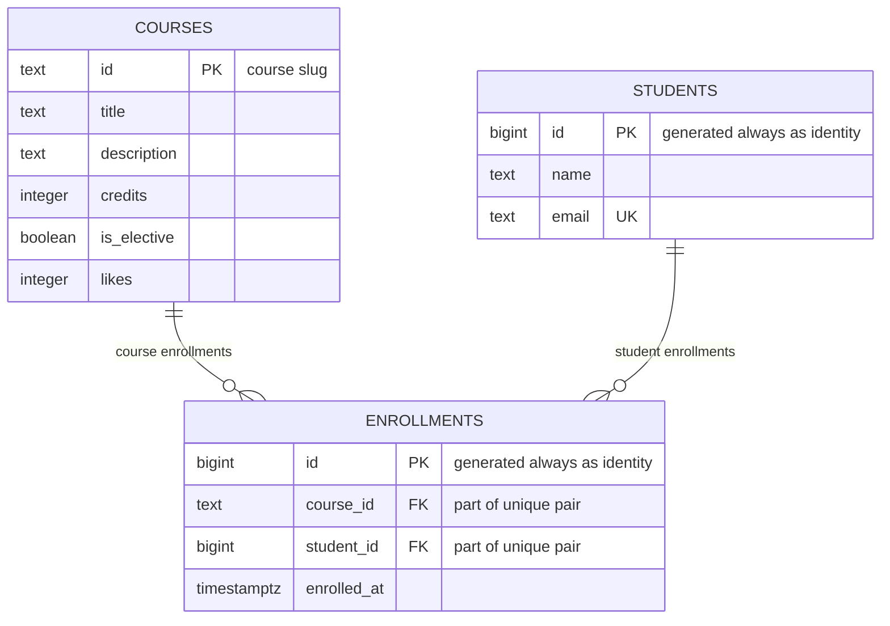

# course-catalog-db

Лабораторная работа 6: схема PostgreSQL для каталога курсов.
Данные курсов совпадают с [data.py предыдущей лабораторной](https://github.com/GitKry12/fastapi/blob/main/data.py).
В этой работе SQL выполняется через `psql`; подключение FastAPI к БД относится к следующей лабораторной.

## How to run

Требуется PostgreSQL **16 или новее** и клиент `psql`. Проверено на Windows, PostgreSQL **17.4**, 30 октября 2026 года. Версия и роль зафиксированы в [environment.txt](experiments/results/environment.txt).

Один раз подключитесь к своему серверу как `postgres`:

```bash
psql -h localhost -U postgres -d postgres
```

Создайте роль без прав суперпользователя и базы:

```sql
CREATE ROLE catalog_app LOGIN PASSWORD 'change-me';
CREATE DATABASE course_catalog OWNER catalog_app;
CREATE DATABASE idx_demo OWNER catalog_app;
CREATE DATABASE norm_demo OWNER catalog_app;
```

`norm_demo` зарезервирована для необязательного задания по нормализации; основная работа использует первые две базы. Если роль и базы уже созданы, повторять эти команды не нужно. Пароль `change-me` — только учебный пример.

Выйдите из psql командой `\q`. Из папки репозитория выполните по очереди:

```bash
psql -h localhost -U catalog_app -d course_catalog -v ON_ERROR_STOP=1 -f schema.sql
psql -h localhost -U catalog_app -d course_catalog -v ON_ERROR_STOP=1 -f seed.sql
psql -h localhost -U catalog_app -d course_catalog -v ON_ERROR_STOP=1 -f queries.sql
```

При запросе пароля введите `change-me`. **schema.sql пересоздаёт таблицы и удаляет их данные** — это учебный способ сброса. Для повторного заполнения снова выполните schema.sql, затем seed.sql: отдельный повтор seed.sql на заполненных таблицах нарушит уникальность. Оба файла обёрнуты в транзакции, чтобы при ошибке не оставить частично выполненные изменения.

В PowerShell перед запуском установите кодировку. Если psql не находится, добавьте путь к установленной версии в PATH текущего окна:

```powershell
$env:PGCLIENTENCODING = 'UTF8'
$env:Path = 'C:\Program Files\PostgreSQL\17\bin;' + $env:Path
```

Обычный сервер использует порт 5432. Для проверки этой работы был запущен отдельный учебный экземпляр на **127.0.0.1:55432**, без изменения существующих баз. Для подключения к нему задайте `$env:PGPORT = '55432'` в PowerShell или добавьте `-p 55432` к командам. Он должен быть запущен; файлы базы не входят в Git. На другом сервере используйте его порт.

Проверка начального состава:

```sql
SELECT (SELECT count(*) FROM courses) AS courses,
       (SELECT count(*) FROM students) AS students,
       (SELECT count(*) FROM enrollments) AS enrollments;
-- 6 | 3 | 6
```

`queries.sql` содержит девять запросов (1, 1b, 2, 2b, 3, 3b, 4, 5, 6). Изменяющие запросы выполняются внутри `BEGIN ... ROLLBACK`, поэтому строки и лайки сохраняются. Номер пробной записи может меняться из-за последовательности IDENTITY.
Результаты: [queries.txt](experiments/results/queries.txt), описание таблиц: [schema.txt](experiments/results/schema.txt), финальная проверка: [verification.txt](experiments/results/verification.txt).

```text
course-catalog-db/
  schema.sql
  seed.sql
  queries.sql
  README.md
  experiments/
    constraints.sql
    idx_data.sql
    index.sql
    verify_transactions.py
    results/                 # фактические результаты psql
```

## Schema



`courses` хранит сведения о курсах, `students` — о студентах, `enrollments` — факты записи. Каждый курс и каждый студент могут иметь много записей; каждая запись относится ровно к одному курсу и одному студенту. Связь многие-ко-многим реализована через `enrollments`, а `UNIQUE (course_id, student_id)` не допускает повторную запись на тот же курс.

## Design decisions

- `courses.id` — текстовый slug из маршрутов прежнего API: он понятен человеку и сохраняет совместимость с существующими ссылками. Текстовый ключ занимает больше места, а его изменение затрагивает ссылки. `students.id` — автоматический bigint: имя и email могут меняться, идентификатор остаётся стабильным; для отображения сведений о студенте требуется JOIN.
- `RESTRICT` запрещает удалять курс, пока на него кто-то записан: сначала нужно явно решить судьбу записей. `CASCADE` удаляет записи вместе со студентом, потому что без него они не имеют смысла. Удаление студента не удаляет сами курсы.
- `timestamptz` хранит момент времени независимо от часового пояса отображения; исходное имя часового пояса он не сохраняет. `timestamp` не задаёт однозначный момент между разными часовыми поясами. `text` подходит для строк без искусственного предела длины; требование к имени выражено явно через CHECK, а не произвольный `varchar(n)`.

## Constraint violation log

Эксперименты действительно выполнены на PostgreSQL **17.4** с `\set VERBOSITY verbose`.
Команды: [experiments/constraints.sql](experiments/constraints.sql).
Полный вывод: [experiments/results/constraints.txt](experiments/results/constraints.txt).
HTTP-коды ниже — предлагаемый ответ будущего API, а не ответ сервера PostgreSQL.

| № | Нарушение | SQLSTATE | Ограничение или поле | Ответ API |
|---|---|---|---|---|
| 1 | NULL в courses.title | 23502 | колонка title; у NOT NULL в PG 17 нет отдельного имени | 422; если NULL пропущен обязательной проверкой Pydantic, ошибка реализации — 500 |
| 2 | courses.credits = 0 | 23514 | courses_credits_check | 422 Unprocessable Entity |
| 3 | courses.likes = -1 | 23514 | courses_likes_check | 500 Internal Server Error: счётчик изменяет код приложения |
| 4 | Имя из одного символа | 23514 | students_name_check | 422 Unprocessable Entity |
| 5 | Повтор email | 23505 | students_email_key | 409 Conflict |
| 6 | Повтор идентификатора курса | 23505 | courses_pkey | 409 Conflict |
| 7 | Повтор пары курс–студент | 23505 | enrollments_course_id_student_id_key | 409 Conflict |
| 8 | Несуществующий курс | 23503 | enrollments_course_id_fkey | 404 Not Found |
| 9 | Несуществующий студент | 23503 | enrollments_student_id_fkey | 404 Not Found: студент не найден |
| 10 | Удаление курса с записями | 23503 | enrollments_course_id_fkey | 409 Conflict |
| 11 | Удаление Данияра с CASCADE | Ошибки нет | enrollments_student_id_fkey | 204 No Content при успешном удалении; в эксперименте выполнен ROLLBACK |

В эксперименте 11 число записей изменилось **6 → 3 → 6**: три записи Данияра удалились вместе со студентом, затем откат восстановил всё. После десяти ошибок и каскадного эксперимента осталось **6 курсов, 3 студента, 6 записей**. В PostgreSQL 18 RESTRICT может возвращать `23001`; здесь зафиксирован фактически полученный `23503` версии 17.4.

Pydantic даёт клиенту понятную ошибку до обращения к базе, но данные могут записывать также SQL-скрипты, другие сервисы и администраторы. Ограничения БД защищают целостность независимо от того, кто выполняет запись, и обеспечивают UNIQUE даже при одновременных запросах. Поэтому проверки API и базы дополняют друг друга.

IDENTITY может пропускать числа: ошибка INSERT и ROLLBACK не возвращают выданный номер последовательности. Номера уникальны благодаря первичному ключу, но не обязаны идти подряд.

## Index: EXPLAIN before and after

Запрос: `SELECT * FROM enrollments WHERE student_id = 777;`.
В `idx_demo` загружено **500 курсов, 20 000 студентов, 50 000 записей**.
Полный вывод трёх начальных планов и шести измерений: [index.txt](experiments/results/index.txt).

| Показатель | До индекса | После индекса |
|---|---|---|
| Метод | Seq Scan | Bitmap Heap Scan + Bitmap Index Scan |
| cost | 0.00..1042.00 | 4.31..15.59 |
| Найдено строк | 3 | 3 |
| Rows Removed by Filter | 49 997 | Не выводится: фильтрация последовательного сканирования не нужна |
| Execution Time, минимум из 3 запусков | 3.488 ms | 0.029 ms |
| Все три измерения | 3.500 / 6.405 / 3.488 ms | 0.125 / 0.029 / 0.033 ms |

До индекса:

```text
Seq Scan on enrollments  (cost=0.00..1042.00 rows=3 width=34)
  Filter: (student_id = 777)
```

После `CREATE INDEX enrollments_student_id_idx ON enrollments (student_id);`:

```text
Bitmap Heap Scan on enrollments  (cost=4.31..15.59 rows=3 width=34)
  Recheck Cond: (student_id = 777)
  -> Bitmap Index Scan on enrollments_student_id_idx  (cost=0.00..4.31 rows=3 width=0)
       Index Cond: (student_id = 777)
```

В этом запуске минимальное время сократилось примерно в **120 раз**; результат зависит от компьютера и кеша. Таблица занимает **3336 kB**, новый индекс — **896 kB**. Индекс расходует место и требует обновления при изменении индексируемых данных.

1. `PRIMARY KEY` и `UNIQUE` создают индексы автоматически, внешний ключ на ссылающейся стороне — нет. Поиск email использует `students_email_key`, а поиск course_id использует первый столбец составного уникального индекса `enrollments_course_id_student_id_key`. Для поиска только по student_id на этих данных PostgreSQL 17 выбрал полный просмотр; отдельный индекс сделал поиск дешевле.
2. Шесть курсов помещаются на одной странице: последовательное чтение дешевле обхода индекса и обращения к таблице. Для трёх совпадений среди 50 000 записей индекс позволяет не читать остальные строки. Планировщик выбирает план по стоимости, а не по факту существования индекса.
3. Индекс student_id ускоряет получение записей одного студента и поиск его дочерних записей при `ON DELETE CASCADE`.

Повторить эксперимент можно командой:

```bash
psql -h localhost -U catalog_app -d idx_demo -v ON_ERROR_STOP=1 -f experiments/index.sql
```

Скрипт проверяет имя базы, пересоздаёт только демонстрационные таблицы, удаляет индекс из базового варианта и затем создаёт его заново. Так эксперимент воспроизводится и после добавления индекса в итоговый schema.sql.

## Transaction

Сценарий: создание Madina Ospanova и запись на курс — две команды INSERT как одна операция.
Проверено двумя независимыми процессами `psql`, соответствующими окнам A и B.
Полная последовательность запросов и ответов: [transactions.txt](experiments/results/transactions.txt).

При попытке записать Мадину на `no-such-course` второй INSERT вернул `23503` (`enrollments_course_id_fkey`). Транзакция перешла в состояние aborted; следующий SELECT тоже завершился ошибкой `25P02`. После `ROLLBACK` число студентов с email `madina@example.com` равно **0**, записей этого студента — **0**, общий состав остался **6 / 3 / 6**. Откат отменил и первый, успешный INSERT.

Во втором сценарии выбран существующий курс `web-security`:

| Момент | Окно A: студент / запись | Окно B: студент / запись |
|---|---|---|
| Оба INSERT выполнены, COMMIT ещё нет | 1 / 1 | 0 / 0 |
| После COMMIT | Зафиксировано | 1 / 1 |

Окно B подтвердило связь `Madina Ospanova — Web Security Essentials`. После фиксации стало **6 курсов, 4 студента, 7 записей**. `SHOW default_transaction_isolation` вернул `read committed`: каждый запрос видит данные, зафиксированные до его начала, и свои изменения в текущей транзакции.

Без общей транзакции первый INSERT мог бы зафиксироваться отдельно, а ошибка второго оставила бы студента без записи на курс. В API обе операции должны выполняться в одной короткой транзакции с COMMIT при успехе и ROLLBACK при ошибке.

Для повторения на начальных данных можно использовать Python 3 и установленный `psql`:

```bash
python experiments/verify_transactions.py
```

Скрипт использует стандартную библиотеку Python и переменные подключения `PGHOST`, `PGPORT`, `PGUSER`, `PGPASSWORD` (либо pgpass). Если `psql` не в PATH, переменная `PSQL` задаёт полный путь к нему. Успешный сценарий действительно фиксирует Мадину; после проверки выполните schema.sql и seed.sql, чтобы вернуть состав 6 / 3 / 6.

## Self-review against the checklist

| Проверка | Результат |
|---|---|
| Keys | Да. У всех трёх таблиц есть PK; обе связи enrollments защищены FK. |
| Types | Да. Slug — text, числовые идентификаторы — bigint, credits/likes — integer, флаг — boolean, момент записи — timestamptz. |
| Required values | Да. Все колонки NOT NULL, включая PK; у is_elective, likes и enrolled_at заданы DEFAULT. |
| Constraints | Да. CHECK для credits > 0, likes >= 0, длины имени >= 2; UNIQUE для email и пары курс–студент. CHECK имени соответствует min_length=2 в API. |
| Deletion | Да. Курс защищён RESTRICT; при удалении студента его записи удаляются CASCADE. Оба поведения проверены. |
| Normalization | Да. Имена/email студентов и свойства курсов хранятся отдельно; enrollments содержит ссылки и момент записи. Списков значений в одной ячейке нет. |
| Indexes and names | Да. Есть индексы PK и UNIQUE, отдельный индекс student_id. Для course_id используется первый столбец составного UNIQUE; дублирующий индекс не добавлен. Имена в snake_case. |

Финальная проверка запускает schema.sql → seed.sql → queries.sql на существующих таблицах, затем повторяет цикл. Проверяются результаты девяти запросов, сохранение 6 / 3 / 6 строк, 11 лайков у api-design, наличие индекса и ограничения. Ошибки в constraints.sql намеренные; этот скрипт включает продолжение после ошибок только для их демонстрации.
